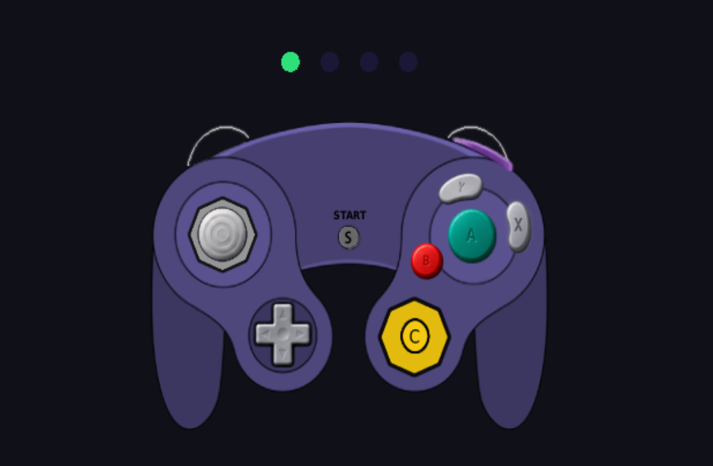

# GC-Controller-Test-Graphic

> Homebrew para Wii y GameCube para probar tus controles de GameCube, ahora con una **interfaz gráfica** que muestra un control interactivo en pantalla.


<p align="center">
  
</p>

---

## 📌 Aviso de fork

Este repositorio es un **fork** del proyecto **[GC-Controller-Test](https://github.com/corenting/GC-Controller-Test)**, creado por **corenting**.

- Proyecto original: https://github.com/corenting/GC-Controller-Test
- Descargas oficiales del original: https://github.com/corenting/GC-Controller-Test/releases

Todo el crédito del trabajo base corresponde al autor original.

---

## 📖 Descripción

Un homebrew sencillo para comprobar el funcionamiento de tus controles de GameCube: botones, sticks y gatillos. Funciona tanto en **Nintendo GameCube** como en **Nintendo Wii**.

La versión original mostraba los valores del control como **números** en pantalla. Este fork reemplaza esa vista por una **representación gráfica de un control de GameCube**: al presionar un botón en el control físico, el botón correspondiente se presiona también en la pantalla, lo que hace mucho más fácil e intuitivo detectar botones que fallan.

---

## ✨ Características

- 🎮 Prueba de controles de GameCube
- 🕹️ **Control gráfico en pantalla** que reacciona en tiempo real a lo que presionas
- 🔘 Botones A, B, X, Y, Start, cruceta, stick principal, C-Stick y gatillos L/R
- 🟢 Indicadores de los 4 puertos de control en la parte superior (se enciende el del puerto conectado)
- 🖥️ Compatible con **GameCube** y **Wii**
- 🐳 Compilación posible con **Docker**, sin instalar devkitPro
- ⚙️ Integración continua con GitHub Actions

---


### Opción 1: con devkitPro instalado

| Consola | Comando |
|---|---|
| GameCube | `TARGET_CONSOLE=gamecube make` |
| Wii | `TARGET_CONSOLE=wii make` |

### Opción 2: sin devkitPro (usando Docker)

El script `build_docker.sh` usa la imagen `devkitpro/devkitppc` para compilar:

```bash
# Para GameCube
./build_docker.sh gamecube

# Para Wii
./build_docker.sh wii
```

---

## 📁 Estructura del repositorio

```
GC-Controller-Test-Graphic/
├── .github/workflows/   # Flujos de integración continua
├── common/              # Código compartido entre GameCube y Wii
├── docs/                # Documentación e imágenes (captura de pantalla)
├── ppc/                 # Código específico de PowerPC
├── Makefile             # Archivo de compilación
├── build_docker.sh      # Script para compilar con Docker
├── LICENSE.md           # Licencia
└── README.md            # Este archivo
```

---

## 🔀 Cambios en este fork

| Original | Este fork |
|---|---|
| Muestra los valores del control como números | Muestra un **control de GameCube gráfico** |
| Lectura de datos en texto | Los botones se **presionan visualmente** en pantalla al usarlos |

El objetivo es que la prueba de controles sea más visual y fácil de interpretar.

---

## 📄 Licencia

Este proyecto hereda la licencia del original. Consulta el archivo [`LICENSE.md`](LICENSE.md) para más detalles.

---

## 🙏 Créditos

- **corenting** — autor original de [GC-Controller-Test](https://github.com/corenting/GC-Controller-Test).
- Fork mantenido por **[TecnoBit-Videojuegos](https://github.com/TecnoBit-Videojuegos)**.
